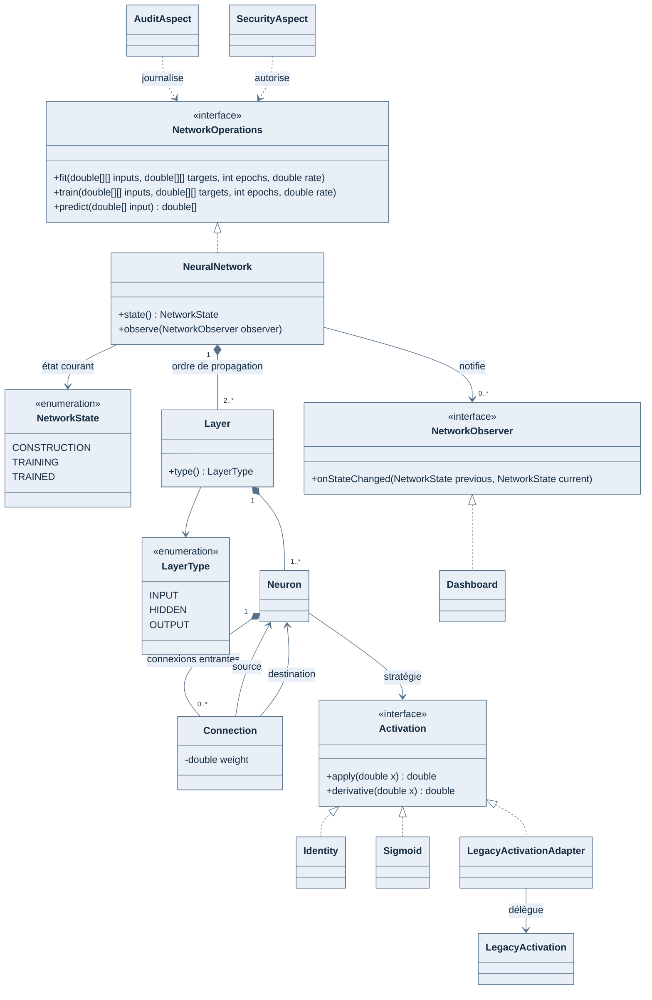

# Réseau de neurones artificiels

Java 21 · Design patterns · Réseau dense à propagation avant

## 1. Diagramme de classes

| Condition | Choix | Justification |
| --- | --- | --- |
| a | **Strategy** | Le neurone délègue l'activation et sa dérivée à l'objet `Activation`. Deux neurones d'une même couche peuvent employer des stratégies différentes. |
| b | **Adapter** | `LegacyActivationAdapter` traduit les appels vers l'interface historique et préserve l'implémentation existante. |
| c | **State** | Chaque état définit les opérations permises. La construction ouvre l'entraînement, et l'état entraîné ouvre la prédiction. |
| d | **Observer** | Le réseau publie les transitions auprès d'abonnés. Le tableau de bord tient ses propres statistiques à partir de ces événements. |
| e | **Aspect de journalisation** | Le suivi des appels et de leur issue se fait autour des opérations, hors du calcul neuronal. |
| f | **Aspect de sécurité** | La vérification des droits est effectuée avant l'accès aux opérations concernées. |

Le réseau possède ses couches ordonnées. Chaque couche possède ses neurones, et chaque neurone de destination possède ses connexions entrantes. Une connexion référence ses deux extrémités. Les connexions vont de chaque neurone d'une couche vers chaque neurone de la suivante. Les neurones d'entrée propagent les valeurs du vecteur, les autres calculent une somme pondérée puis leur activation.
