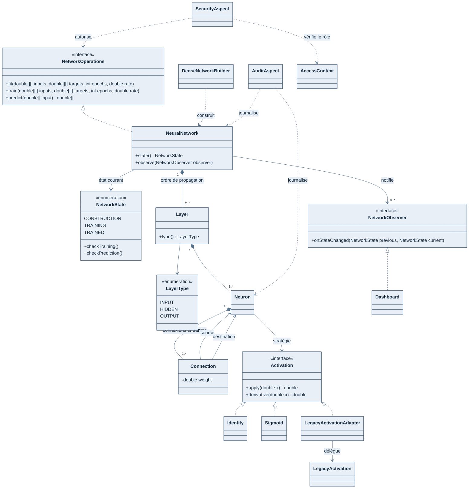
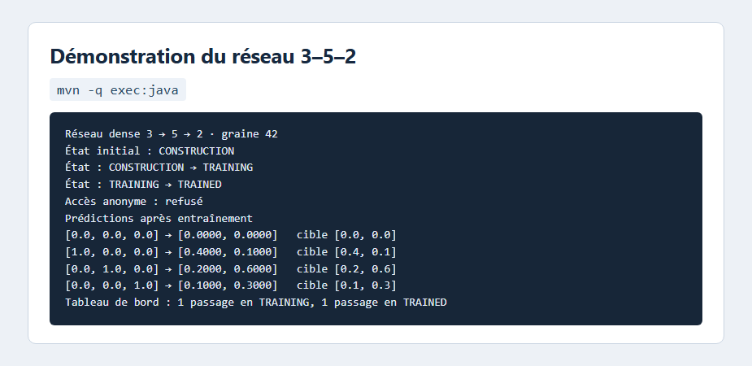
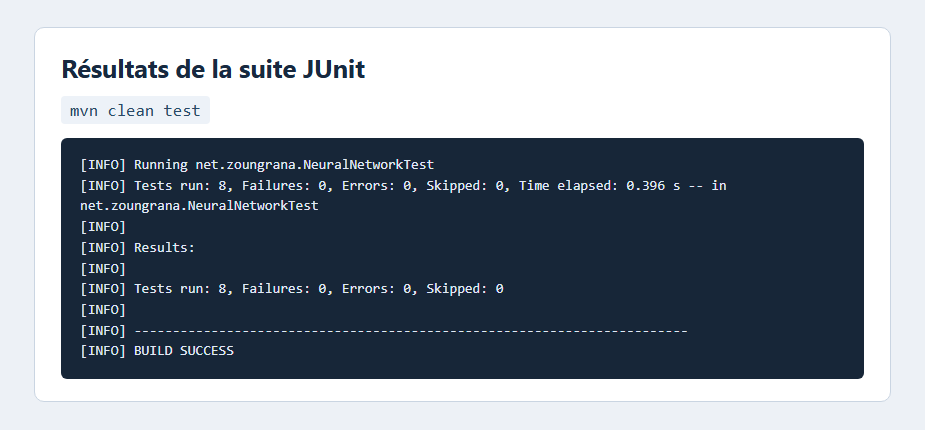

# Réseau de neurones artificiels

Java 21 · Design patterns · Réseau dense à propagation avant

[Diagramme](#1-diagramme-de-classes) · [Implémentation](#2-implémentation) · [Tests](#3-rapport-et-tests) · [Améliorations](#4-améliorations) · [Archive](#5-archive)

## 1. Diagramme de classes



| Condition | Choix | Justification |
| --- | --- | --- |
| a | **Strategy** | Le neurone délègue l'activation et sa dérivée à l'objet `Activation`. Deux neurones d'une même couche peuvent employer des stratégies différentes. |
| b | **Adapter** | `LegacyActivationAdapter` traduit les appels vers l'interface historique et préserve l'implémentation existante. |
| c | **State** | Chaque état définit les opérations permises. La construction ouvre l'entraînement, et l'état entraîné ouvre la prédiction. |
| d | **Observer** | Le réseau publie les transitions auprès d'abonnés. Le tableau de bord tient ses propres statistiques à partir de ces événements. |
| e | **Aspect de journalisation** | Le suivi des appels et de leur issue se fait autour des opérations, hors du calcul neuronal. |
| f | **Aspect de sécurité** | La vérification des droits est effectuée avant l'accès aux opérations concernées. |

Le réseau possède ses couches ordonnées. Chaque couche possède ses neurones, et chaque neurone de destination possède ses connexions entrantes. Une connexion référence ses deux extrémités. Les connexions vont de chaque neurone d'une couche vers chaque neurone de la suivante. Les neurones d'entrée propagent les valeurs du vecteur, les autres calculent une somme pondérée puis leur activation.

## 2. Implémentation

| Élément | Fichier |
| --- | --- |
| Propagation avant, rétropropagation et cycle de vie | [NeuralNetwork.java](src/main/java/net/zoungrana/NeuralNetwork.java) |
| Somme pondérée et stratégie par neurone | [Neuron.java](src/main/java/net/zoungrana/Neuron.java) |
| Poids et bornes | [Connection.java](src/main/java/net/zoungrana/Connection.java) |
| Règles d'état et tableau de bord | [NetworkState.java](src/main/java/net/zoungrana/NetworkState.java), [Dashboard.java](src/main/java/net/zoungrana/Dashboard.java) |
| Tissage et contrôle d'accès | [AuditAspect.aj](src/main/aspect/net/zoungrana/AuditAspect.aj), [SecurityAspect.aj](src/main/aspect/net/zoungrana/SecurityAspect.aj) |

**Calcul.** Chaque neurone hors entrée calcule sa somme pondérée `S = Σᵢ xᵢwᵢ`, puis applique sa stratégie à `S`. L'entraînement supervisé minimise la demi-somme des carrés des écarts par descente de gradient, avec une mise à jour après chaque exemple. La rétropropagation calcule tous les gradients avant de modifier les poids. Chaque mise à jour est projetée sur l'intervalle `[0, 1]`. Le modèle suit l'énoncé en utilisant des connexions sans biais.

**Cycle de vie.** L'état initial est `CONSTRUCTION`. L'énoncé mentionne à la fois `fit` et `train` pour lancer l'entraînement. Ici, `fit` délègue à `train` et les deux suivent le parcours `CONSTRUCTION → TRAINING → TRAINED`. Une erreur après le début de l'entraînement restaure les poids et ramène le réseau en `CONSTRUCTION`. L'état `TRAINED` autorise `predict` et clôt l'entraînement de cette instance. Le tableau de bord compte les entrées dans chaque état à partir des notifications reçues.

**Journalisation.** AspectJ tisse les exécutions de méthodes du code applicatif, y compris les méthodes privées et les appels internes. Le journal `net.zoungrana.audit` utilise le niveau `FINER` et enregistre le nom de la méthode, l'issue de l'appel et le type d'exception en cas d'échec. Les données d'entrée et de sortie restent hors du journal.

**Autorisation.** `TRAINER` peut lancer l'entraînement. `READER` et `TRAINER` peuvent prédire une fois le réseau entraîné. Un appel sans rôle est refusé pour ces opérations. Dans la démonstration, le point d'entrée de confiance établit localement le rôle pour la durée de l'appel. Dans une application avec comptes utilisateurs, cette attribution relèverait de la couche d'authentification.

## 3. Rapport et tests

Ce README rassemble la conception, les liens vers le code et les résultats de vérification. Il tient lieu de rapport.

Avec **JDK 21** et **Maven** à la racine du dépôt, exécuter les commandes suivantes. Le build Maven applique le tissage AspectJ.

```sh
mvn clean test
mvn -q exec:java
```

| Vérification | Résultat attendu |
| --- | --- |
| Cycle de vie et Observer | Passage par `TRAINING` puis `TRAINED`, avec une notification par transition |
| Apprentissage | Valeur cible apprise dans le réseau linéaire et dans le réseau à deux couches cachées |
| Validation | Dimensions invalides ou valeurs non finies rejetées, prédiction réservée à l'état entraîné |
| Poids | Projection sur `[0, 1]` et restauration après interruption de l'entraînement |
| Adapter | Valeur et dérivée transmises via l'interface historique |
| Aspects | Accès anonyme et entraînement par un lecteur refusés, échec et méthodes privées journalisés |

### Exécution locale





La démonstration réutilise les quatre exemples d'entraînement pour vérifier la propagation et l'apprentissage. Ces résultats mesurent l'ajustement à ces exemples.

## 4. Améliorations

**Builder.** [DenseNetworkBuilder](src/main/java/net/zoungrana/DenseNetworkBuilder.java) construit des réseaux denses à zéro, une ou plusieurs couches cachées. Il valide la taille des couches, relie automatiquement les couches adjacentes et permet de choisir une activation par neurone. Une graine rend les poids de départ reproductibles.

**Facade.** L'interface `NetworkOperations`, implémentée par `NeuralNetwork`, offre les opérations d'entraînement et de prédiction sans exposer le câblage, les valeurs intermédiaires ou la mise à jour des poids. Elle définit aussi le périmètre des opérations protégées par l'aspect de sécurité.

## 5. Archive

L'archive produite à partir du dépôt contient le README, les captures, les sources Java et AspectJ, les tests et le fichier Maven. Cette commande la recrée à partir du commit courant.

```sh
git archive --format=zip --prefix=examen-reseau-de-neurone/ --output=examen-reseau-de-neurone.zip HEAD
```
